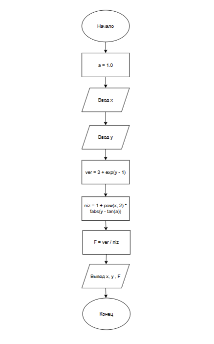

# Домашнее задание к работе 5

## Условие задачи
F(x,y)=(3+e^(y-1))/(1+x^2|y-tga|)

## 1. Алгоритм и блок-схема

### Алгоритм
1. **Начало**
2. Объявить константы:
   a = 1.0
3. Ввести значение x
4. Ввести значение y
4. Вычислить числитель: ver = 3 + e^(1-y)
5. Вычислить знаменатель: niz = 1 + x^2 * |y - tg(a)|
6. Вычислить значение функции: F = ver / niz
7. Вывести значения x, y, F
8. **Конец**

### Блок-схема
 
[https://github.com/uliases00/domashnya-5/blob/main/diagramma5.png]

## 2. Реализация программы

#define _CRT_SECURE_NO_WARNINGS 
#include <locale.h> 
#include <stdio.h> 
#include <math.h> 

int main() 
{ 
	setlocale(LC_CTYPE, ".UTF-8"); 

	const double a = 1.0;
	double x, y;
	double ver, niz, F;

	printf("Введите значение x:\n");
	scanf("%lf", &x);
	printf("Введите значение y:\n");
	scanf("%lf", &y);

	ver = 3 + exp(y - 1.0);
	niz = 1 + x * x * fabs(y - tan(a));
	F = ver / niz;

	printf("F(%.6g, %.6g)=%.6f", x, y, F);

	return 0;
} 

## 3. Результаты работы программы

Введите значение x:
3
Введите значение y:
2
F(3, 2)=1.147482

## 4. Информация о разработчике

Черкасова Ульяна Алексеевна бТИИ-261 (1 подгруппа)
